<p align="center">
  <picture>
    <source media="(prefers-color-scheme: dark)" srcset="docs/assets/logo-dark.svg">
    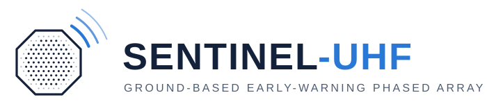
  </picture>
</p>

<p align="center">
  <b>A complete reference design for a two-face UHF early-warning phased-array radar</b><br>
  system sizing · antenna design and EM simulation · seven KiCad PCB projects · site visualisation
</p>

<p align="center">
  
  
  
  
  
  
</p>

<p align="center">
  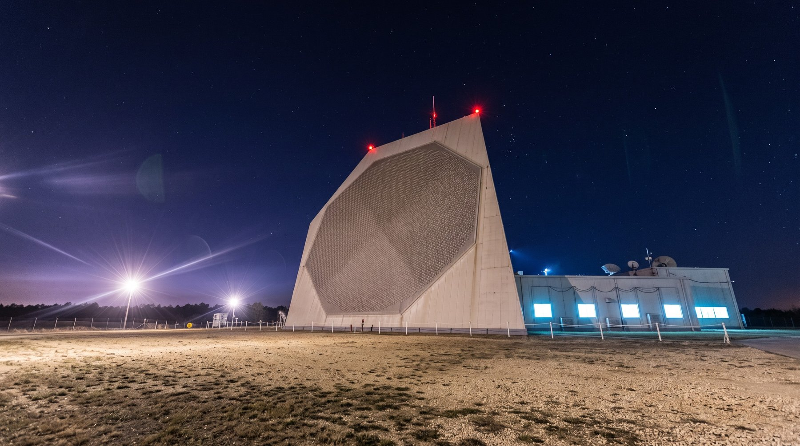
  <br><sub>AI visualisation (Pixelcut / Nano Banana 2.1) generated from the project's Blender model. Site details are illustrative.</sub>
</p>

---

## Contents

- [What this is](#what-this-is)
- [Key numbers](#key-numbers)
- [Architecture](#architecture)
- [System design](#system-design)
- [Antenna and EM simulation](#antenna-and-em-simulation)
- [Electronics: seven custom boards](#electronics-seven-custom-boards)
- [Site and building](#site-and-building)
- [Cost estimate](#cost-estimate)
- [Repository layout](#repository-layout)
- [Reproduce everything](#reproduce-everything)
- [Verification status and known gaps](#verification-status-and-known-gaps)
- [Notes](#notes)

## What this is

SENTINEL-UHF is an engineering reference design for a ground-based early-warning radar in the class of
PAVE PAWS / UEWR. It is built from public radar engineering principles, and every number in it comes from code in
this repository:

- a **system budget** (aperture, power, detection range, search fence, data rates),
- an **antenna element** sized with a **method-of-moments EM solver** written for the project and validated against
  textbook results, including a 61-element mutual-coupling and scan-impedance study,
- **seven complete KiCad 10 projects** covering every custom board in the radar, each with a schematic, PCB, gerbers
  and its own symbol/footprint library,
- a **Blender model** of the site and a photorealistic visualisation.

It is a first-pass design meant for study and as a starting point. It is not a fielded system and nothing here is
released for fabrication.

## Key numbers

| | |
|---|---|
| Band | 420–450 MHz (UHF radiolocation), circular polarisation |
| Faces | 2 × 120° = 240° azimuth, tilted back 20° |
| Aperture | 22 m active circle per face, **2,587 elements** on a 0.41 m triangular lattice |
| Gain / beamwidth | 39.1 dBi / 1.83° at broadside |
| Peak / average RF | **776 kW / 155 kW per face** (300 W GaN per element, 20 % duty) |
| Detection, 10 m² target | **6,301 km** broadside · 5,951 km at 30° · 3,855 km at 60° (incl. EM mismatch loss) |
| Search fence | 135 beams over 120° × 3°, 10.8 s frame |
| Digital back end | 324 RFSoC tiles per face, 1.03 Tb/s element data → 6.4 Gb/s after beamforming |
| Site prime power | 1.45 MW |

## Architecture

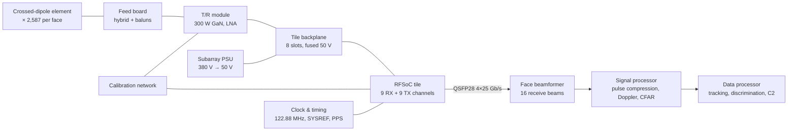

Every element has its own T/R module and its own ADC/DAC channel. There is no analog beamforming network: beams are
formed digitally, so one face can hold a search fence and track several targets in the same dwell.

## System design

`radar_sizing.py` sizes the radar from first principles (Skolnik, *Radar Handbook*). The lattice spacing is set so
no grating lobes appear out to 60° scan at 450 MHz. The result, 2,587 elements in 22 m, lands very close to the
fielded PAVE PAWS (2,677 positions in 22.1 m), which is a useful sanity check.

<p align="center">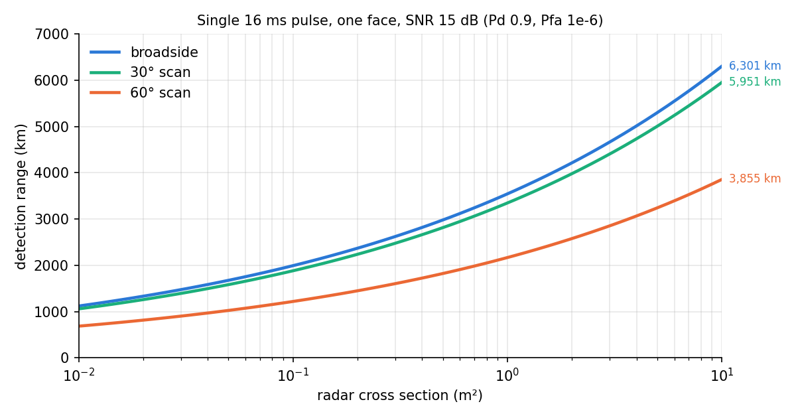</p>

| Waveform | Pulse | Bandwidth | Range resolution | Use |
|---|---|---|---|---|
| Long-range search | 16 ms LFM | 100 kHz | 1.5 km | horizon fence |
| Track | 2–8 ms LFM | 1 MHz | 150 m | track updates |
| Discrimination | 0.25–2 ms LFM | 10 MHz | 15 m | object separation |

## Antenna and EM simulation

Each element is a pair of crossed 12 mm aluminium dipoles, **28 cm long, 18 cm above the
face**, combined in a 90° hybrid for circular polarisation.

The element was designed with `antenna/mom.py`, a thin-wire method-of-moments solver written for this project
(rooftop basis functions, Galerkin testing, image theory for the ground plane, delta-gap ports). It reproduces the
textbook half-wave dipole: **84 + j45 Ω and 2.16 dBi** (theory: 2.15 dBi). `antenna/simulate.py` then solves a
**61-element hexagonal patch** (122 ports, 1,830 unknowns) at 420, 435 and 450 MHz to get the full coupling matrix,
the active reflection coefficient versus scan, and the embedded element pattern.

| Result (centre element) | Value |
|---|---|
| Embedded realised gain, broadside | 4.8 dBi (ideal cell 5.9 dBi) |
| Axial ratio, broadside | 1.3 dB |
| Nearest-neighbour coupling | -19.6 dB |
| Worst active reflection, band × ±60° | -3.4 dB |

<p align="center">
  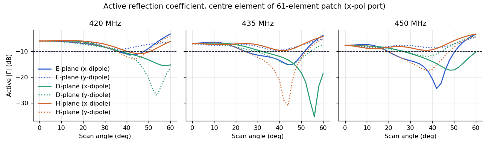
  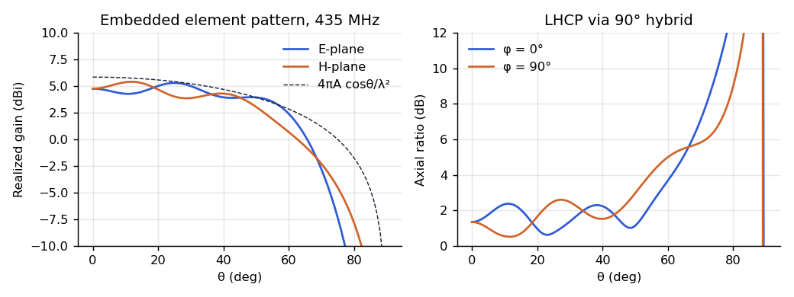
  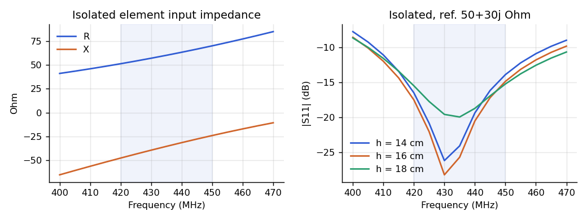
</p>

> **Where it falls short.** The match holds to about −9 dB out to 45° but drops to about −4 dB at 60°, which costs
> about 2.2 dB per pass at the scan edge (already included in the detection numbers). A lattice trade study
> (`antenna/explore.py`) showed a tighter 0.37 m grid gains under 1 dB, which isn't worth 30 % more modules.
> The next step is a wide-angle matching sheet, checked in a full-wave model that includes the balun and feed posts.

## Electronics: seven custom boards

Every custom board is generated from a Python circuit description (`gen_schematic.py` / `gen_design.py`) and checked by
KiCad itself:

1. **ERC**: electrical rules, 0 violations required.
2. **Netlist intent check**: KiCad's extracted netlist is compared pin-for-pin with the intended circuit.
3. **Layout**: a shared placement / fan-out / A* routing engine (`hardware/tools/pcbgen.py`) lays out the board on 4
   layers (signal / solid ground / power + signal / signal), then KiCad DRC checks it, refills the zones and verifies
   parity with the schematic.

| Board | Per face | Role | Parts | Nets | ERC | Netlist | Layout | Size |
|---|---|---|---|---|---|---|---|---|
| **T/R module** | 2,587 | GaN PA chain, receiver, protection, bias, telemetry | 144 | 90 | 0 | ✔ | ✅ DRC clean | 230 × 152 mm |
| **Element feed board** | 2,587 | 90 deg hybrid, matching, baluns into the crossed dipoles | 19 | 11 | 0 | ✔ | ✅ DRC clean | 86 × 56 mm |
| **RFSoC digitiser tile** | 324 | SOM carrier: 9 RX + 9 TX channels, module links, QSFP28 | 118 | 187 | 0 | ✔ | ✅ DRC clean | 320 × 260 mm |
| **Tile backplane** | 324 | 8 module slots, fused 50 V drain bus, point-to-point control | 57 | 59 | 0 | ✔ | ✅ DRC clean | 232 × 112 mm |
| **Subarray power supply** | 324 | 380 V -> 50 V, two 600 W bricks, supervisor, 2.5 mm HV rules | 56 | 38 | 0 | ✔ | ✅ DRC clean | 300 × 185 mm |
| **Calibration network** | 324 | SPDT selector tree + inject/measure switch on the module CAL ports | 37 | 25 | 0 | ✔ | ✅ DRC clean | 120 × 82 mm |
| **Clock & timing** | 41 | PLL-cleaned 122.88 MHz, SYSREF from PPS, LVDS to 8 tiles | 63 | 82 | 0 | ✔ | ✅ DRC clean | 150 × 130 mm |

7 of 7 layouts are DRC-clean with zero unrouted nets.

### T/R module
`hardware/tr_module/` · 2,587 per face · 144 parts · 90 nets · ✅ DRC clean

📄 [Bill of materials (CSV)](hardware/tr_module/export/SENTINEL_TRM_BOM.csv) · [Schematic (PDF)](hardware/tr_module/export/SENTINEL_TRM_schematic.pdf) · [Gerbers](hardware/tr_module/export/gerbers)

GaN driver + 300 W GaN final, drop-in circulator, 30 dB coupler, two-stage PIN/Schottky limiter, LNA (NF 0.5 dB), SAW filter. Hardware sequencing interlock: the drain switch closes only when `TX_EN` AND gate-bias-OK AND MCU-enable. STM32G031 monitors drain current, VSWR, temperature and both gates.

<p align="center">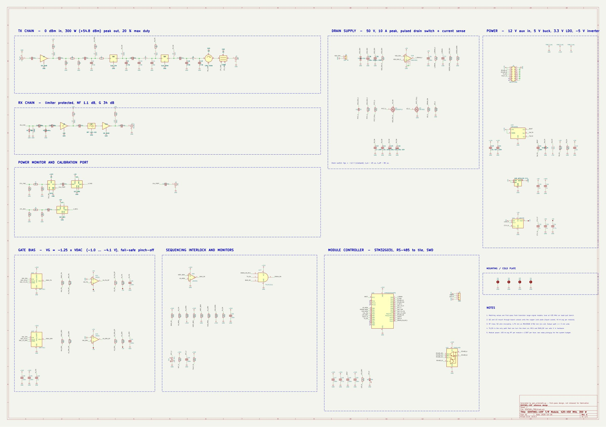 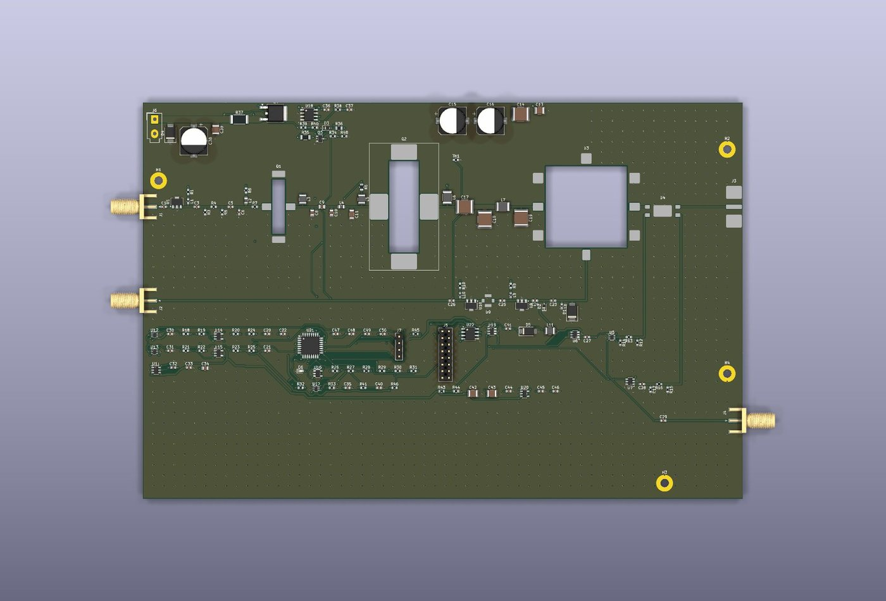</p>

### Element feed board
`hardware/feed_board/` · 2,587 per face · 19 parts · 11 nets · ✅ DRC clean

📄 [Bill of materials (CSV)](hardware/feed_board/export/SENTINEL_FEED_BOM.csv) · [Schematic (PDF)](hardware/feed_board/export/SENTINEL_FEED_schematic.pdf) · [Gerbers](hardware/feed_board/export/gerbers)

3 dB 90° hybrid for circular polarisation, isolated port into a 100 W load, per-dipole matching from the EM model (x: series 11.2 nH; y: shunt 3.9 pF + series 20.7 nH), 1:1 baluns, static-bleed chokes.

<p align="center">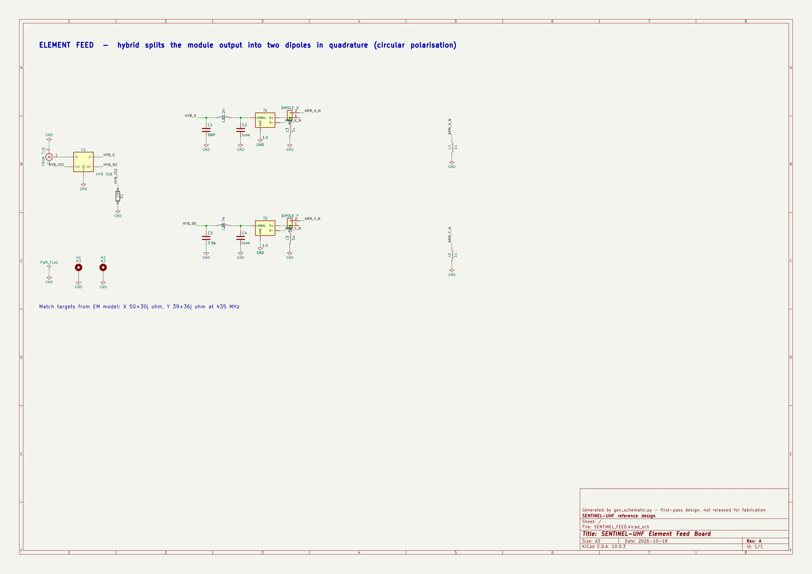 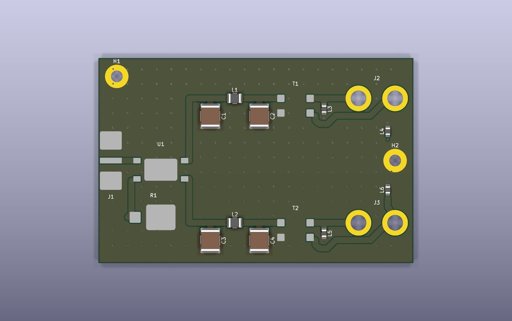</p>

### RFSoC digitiser tile
`hardware/rfsoc_tile/` · 324 per face · 118 parts · 187 nets · ✅ DRC clean

📄 [Bill of materials (CSV)](hardware/rfsoc_tile/export/SENTINEL_TILE_BOM.csv) · [Schematic (PDF)](hardware/rfsoc_tile/export/SENTINEL_TILE_schematic.pdf) · [Gerbers](hardware/rfsoc_tile/export/gerbers)

Carrier for a commercial RFSoC system-on-module: 9 receive channels (SMA → 1:2 balun → ADC), 9 transmit channels (DAC → centre-tapped balun → SMA), eight RS-485 module links, clock input, calibration control, QSFP28 (4 × 25 Gb/s) to the beamformer, 12 V → 3.3 V / 3 A buck. Routed with the EasyEDA Pro autorouter (Top / In2 / Bottom, In1 solid GND) and imported back into KiCad (`tools/import_easyeda.py`, `easyeda_routes.json`).

<p align="center">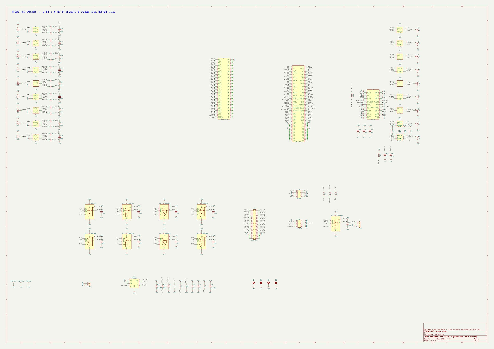 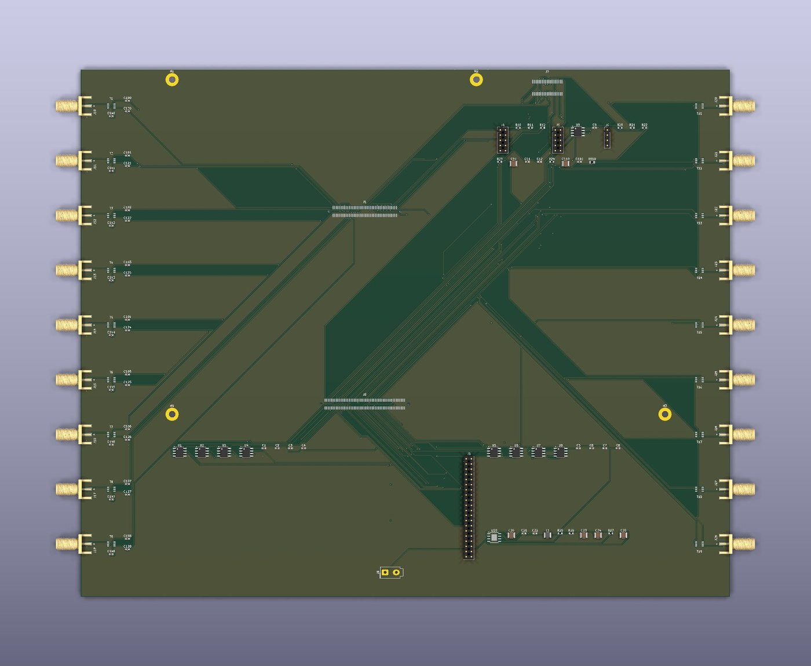</p>

### Tile backplane
`hardware/backplane/` · 324 per face · 57 parts · 59 nets · ✅ DRC clean

📄 [Bill of materials (CSV)](hardware/backplane/export/SENTINEL_BACKPLANE_BOM.csv) · [Schematic (PDF)](hardware/backplane/export/SENTINEL_BACKPLANE_schematic.pdf) · [Gerbers](hardware/backplane/export/gerbers)

Eight module slots. Each gets a 15 A fuse on the 50 V drain bus and a resettable fuse on 12 V aux. All control lines run point-to-point to one 40-pin cable for the tile, so a faulty module cannot disturb its neighbours.

<p align="center">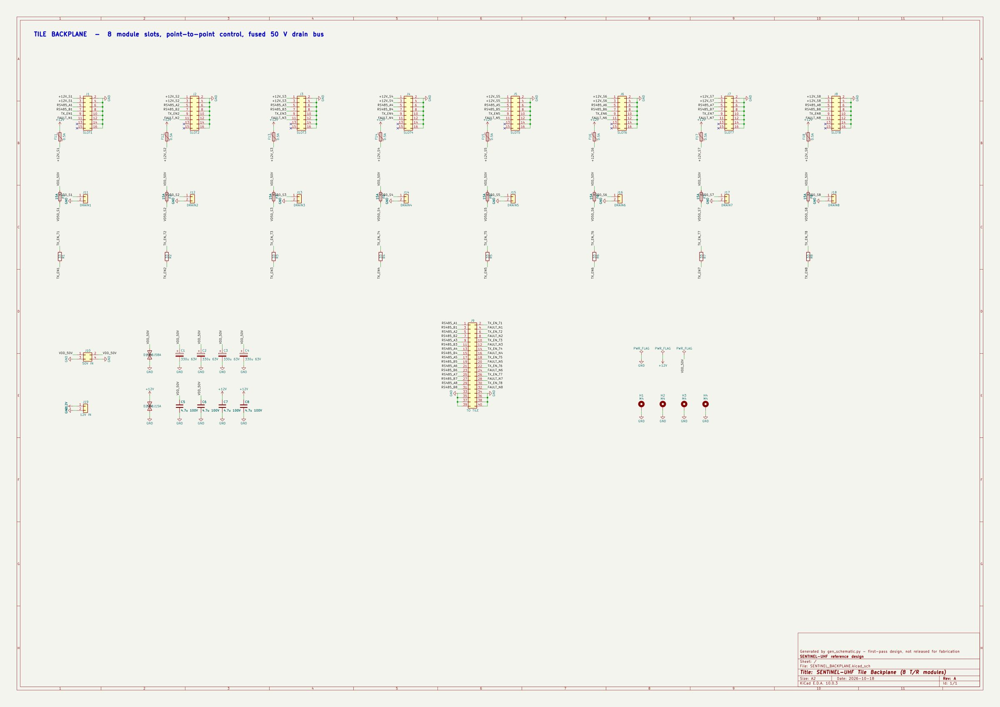 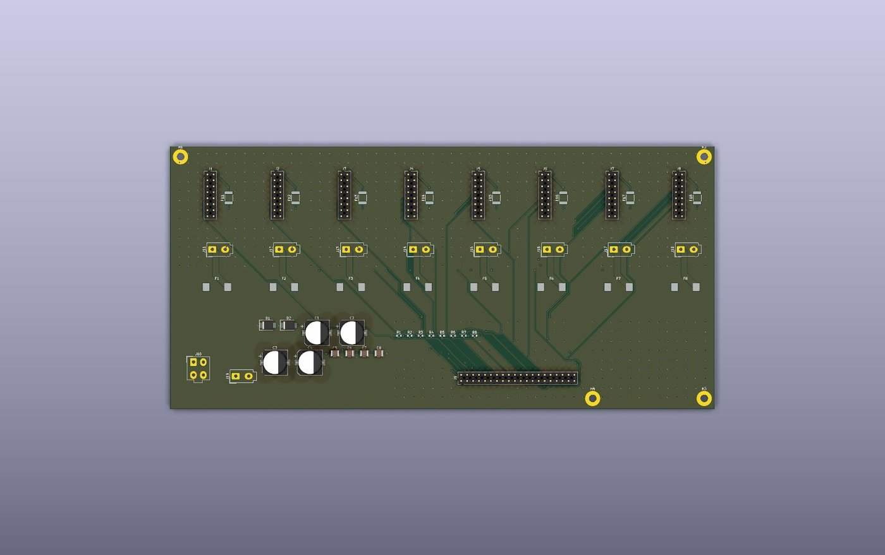</p>

### Subarray power supply
`hardware/psu/` · 324 per face · 56 parts · 38 nets · ✅ DRC clean

📄 [Bill of materials (CSV)](hardware/psu/export/SENTINEL_PSU_BOM.csv) · [Schematic (PDF)](hardware/psu/export/SENTINEL_PSU_schematic.pdf) · [Gerbers](hardware/psu/export/gerbers)

380 VDC → 50 V: two isolated 600 W full bricks (current-shared, OR-ed), NTC inrush limiter with relay bypass, opto-isolated enables, STM32 supervisor, 12 V aux brick. Pulse energy (87 A for 16 ms) comes from a chassis capacitor bank on M6 studs. Primary nets enforce IPC-2221 2.5 mm clearance through KiCad custom rules.

<p align="center">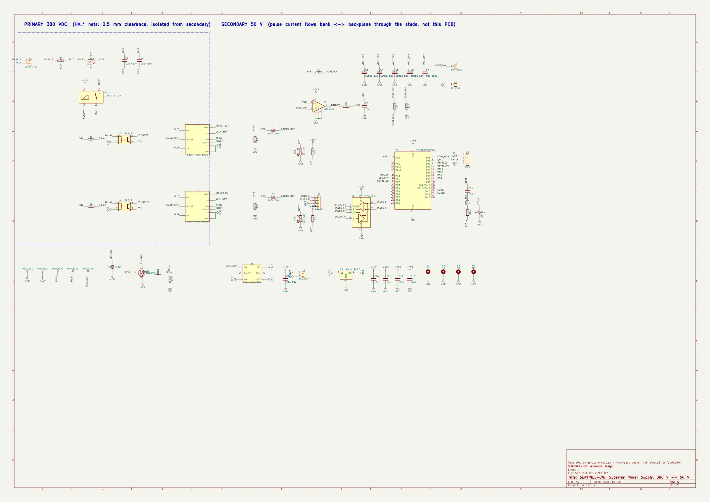 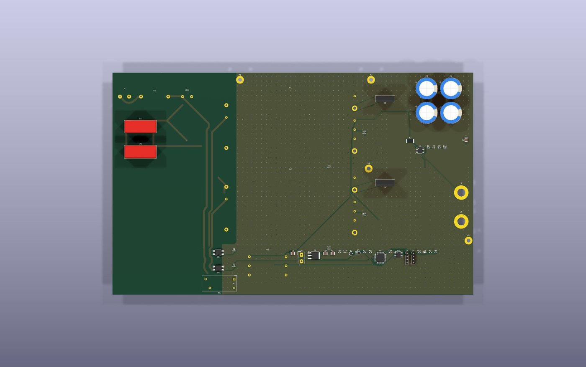</p>

### Calibration network
`hardware/cal_board/` · 324 per face · 37 parts · 25 nets · ✅ DRC clean

📄 [Bill of materials (CSV)](hardware/cal_board/export/SENTINEL_CAL_BOM.csv) · [Schematic (PDF)](hardware/cal_board/export/SENTINEL_CAL_schematic.pdf) · [Gerbers](hardware/cal_board/export/gerbers)

Binary tree of seven SPDT switches (8 → 1, one select bit per level) plus an inject/measure switch, so the tile can inject into or measure every module's coupler port through one common path.

<p align="center">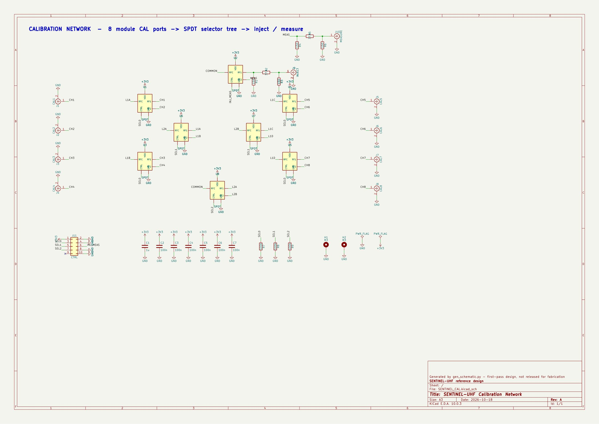 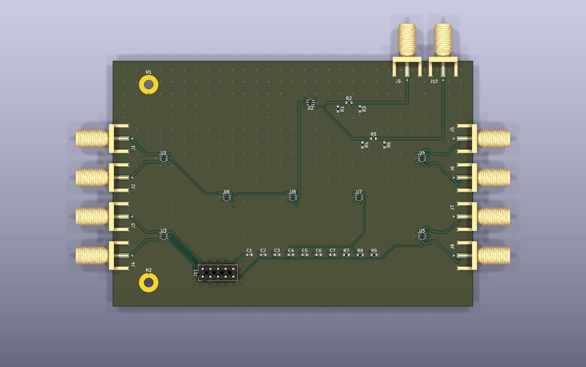</p>

### Clock & timing
`hardware/clock_board/` · 41 per face · 63 parts · 82 nets · ✅ DRC clean

📄 [Bill of materials (CSV)](hardware/clock_board/export/SENTINEL_CLOCK_BOM.csv) · [Schematic (PDF)](hardware/clock_board/export/SENTINEL_CLOCK_schematic.pdf) · [Gerbers](hardware/clock_board/export/gerbers)

Narrow-loop PLL locks a 122.88 MHz VCXO to the site 10 MHz. SYSREF is PPS re-timed by the clean clock in a D flip-flop, so it is phase-aligned on every tile. Six quad LVDS drivers feed 8 tiles.

<p align="center">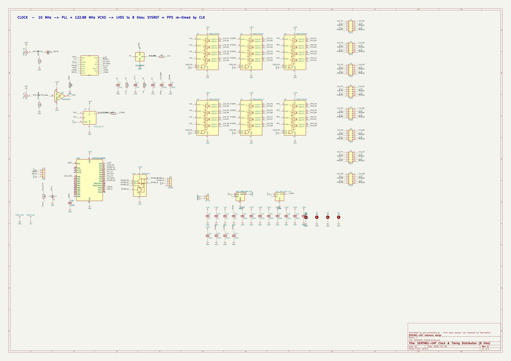 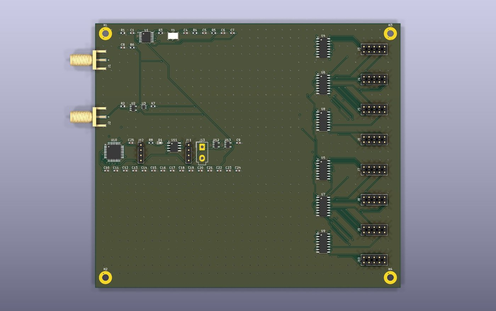</p>

## Site and building

<p align="center">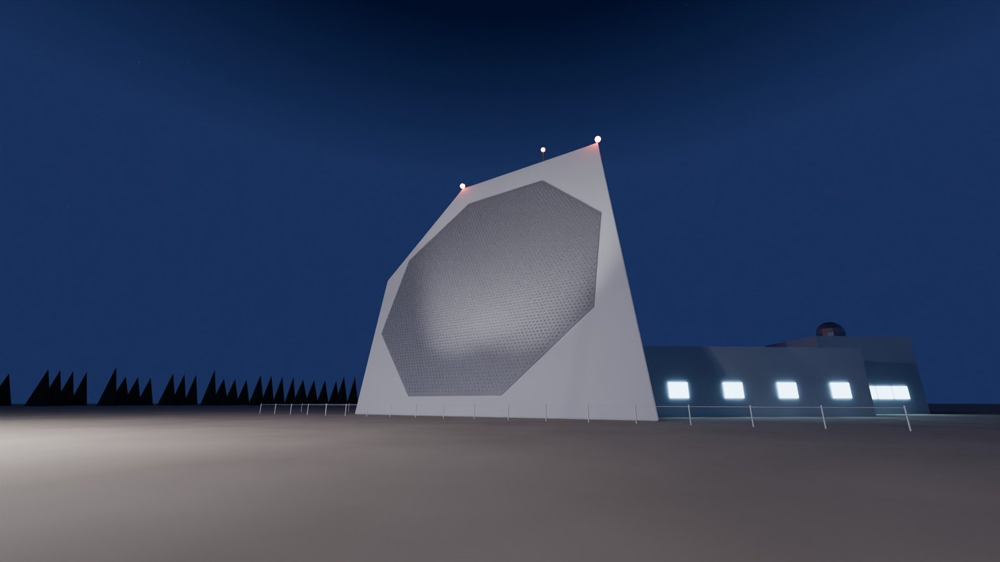</p>

`render/build_radar.py` builds the site procedurally in Blender. The building is a 48 m equilateral triangle in plan
with its front corner truncated, 32 m high, with both array faces tilted back 20°. Each 33 m face carries a 28 m
octagon of **4,305 crossed-dipole positions**: the 2,587 active elements in the 22 m circle, plus terminated dummy
elements around them. That ratio (60 % active) is close to PAVE PAWS (1,792 of 2,677).

<p align="center">
  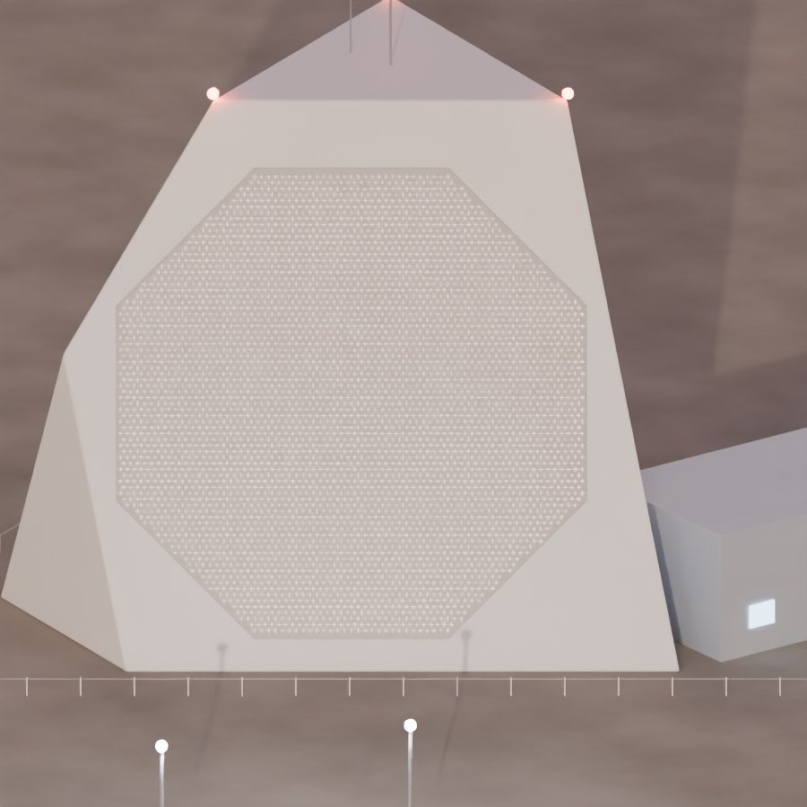
  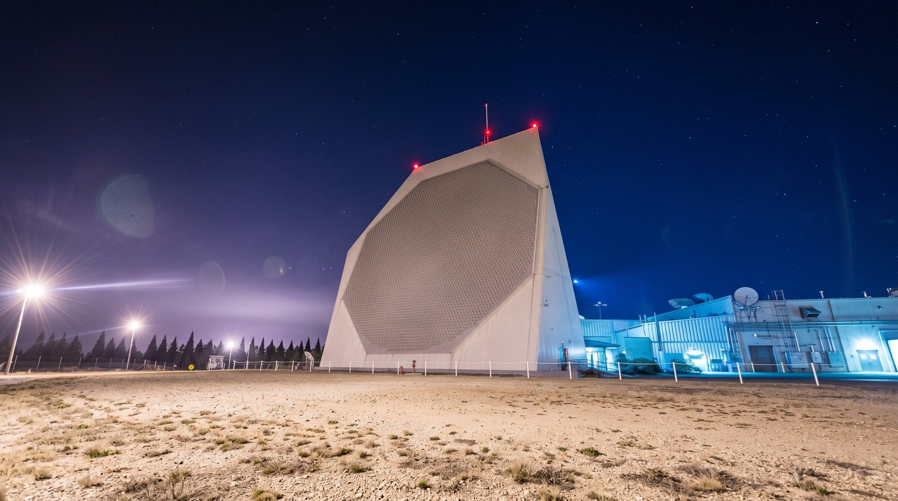
</p>

## Cost estimate

Rough order of magnitude for one two-face site, using commercial GaN and RFSoC prices at production volume:

| Item | Basis | $M |
|---|---|---|
| T/R modules | 5,174 × $4–6k | 21–31 |
| RFSoC tiles | 648 × $8–12k | 5–8 |
| Antenna faces | elements, hybrids, ground plane | 5–9 |
| Beamformer and processors | FPGA + GPU | 10–18 |
| Power and cooling | substation, gensets, chillers | 15–25 |
| Building and site works | 32 m structure, security | 40–80 |
| Software | scheduler, tracking, discrimination, C2 | 40–100 |
| Integration, calibration, test | | 20–40 |
| Engineering and program | | 30–60 |
| **Total acquisition** | | **≈ 186–371** |

Equipment alone is about $56–91M. Military-qualified modules ($10–20k each) and software overruns are the biggest
risks. Operation adds roughly $15–25M per year. The > $1 billion figures quoted for fielded radars include decades
of operation, security and program overhead.

## Repository layout

```
radar_sizing.py            system budget (run it first)
antenna/                   MoM solver, element + 61-element array study, lattice trade study, results/
hardware/
  tools/                   schematic writer, PCB engine, KiCad build / ERC / DRC scripts
  tr_module/               T/R module           (KiCad project + generators + gerbers)
  feed_board/              element feed board
  rfsoc_tile/              RFSoC digitiser tile (SOM carrier)
  backplane/               tile backplane
  psu/                     subarray power supply
  cal_board/               calibration network
  clock_board/             clock & timing distribution
render/                    Blender site model and renders
report/                    interactive HTML design report (build_report.py)
docs/                      logo, README figures, generators
```

Each `hardware/<board>/` folder holds `SENTINEL_*.kicad_pro/.kicad_sch/.kicad_pcb`, its `SENTINEL.kicad_sym` /
`SENTINEL.pretty` libraries, `export/` (schematic PDF, grouped BOM CSV, 3D view, gerbers + drill files) and the generators.

## Reproduce everything

Requires Python 3.13 with numpy, scipy, matplotlib, shapely, pillow and PyMuPDF, plus KiCad 10 and Blender 5.2.

```bash
python radar_sizing.py
cd antenna && python simulate.py && cd ..                              # ~8 min
cd hardware/tr_module && python gen_footprints.py && python gen_schematic.py && cd ../..
bash hardware/tools/sch_check.sh hardware/tr_module SENTINEL_TRM        # ERC + netlist check + footprint dump
python hardware/tr_module/pcb_plan.py                                  # place + route (~30-60 min)
bash hardware/tools/pcb_check.sh hardware/tr_module SENTINEL_TRM        # build board, DRC, 3D view, gerbers
bash hardware/tools/export_bom.sh                                      # grouped BOM CSV for every board
# same pattern for the other boards (gen_design.py, then the two check scripts)
blender -b -P render/build_radar.py -- night 64
python report/build_report.py && python docs/make_figures.py && python docs/make_readme.py
```

## Verification status and known gaps

| Item | Status |
|---|---|
| System budget | ✅ cross-checked against public PAVE PAWS figures |
| MoM solver | ✅ validated on the half-wave dipole |
| Element + array EM model | ✅ 61 elements, 3 frequencies, full coupling (thin-wire, infinite ground) |
| Wide-angle match | ⚠️ ~−4 dB at 60°: needs a WAIM sheet and full-wave verification |
| All 7 schematics | ✅ 0 ERC violations, exact netlist match |
| PCB layouts | 7/7 DRC-clean; the rest are being routed |
| Differential pairs | ⚠️ data-converter, LVDS and 25 Gb/s pairs are auto-routed as single nets; need a manual coupled, length-matched pass |
| Pin maps not in the KiCad library | ⚠️ RFSoC SOM connector, PLL and RF modules use this project's own pin maps; map to the chosen parts' datasheets |
| T/R module matching values | ⚠️ first-pass from device models; tune on a load-pull bench |
| Thermal | ⚠️ 45 W average per module on a cold plate; needs CFD and a test article |

## Notes

- **No license.** This repository is published without a license. All rights are reserved by the author; viewing
  is fine, but reuse needs permission.
- Designed with [Claude Code](https://claude.com/claude-code). The radar is a study design built from public
  engineering principles; it does not reproduce any classified or proprietary system design.
